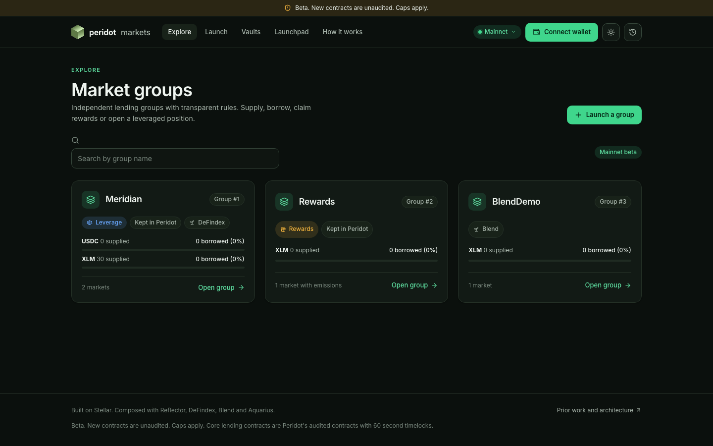
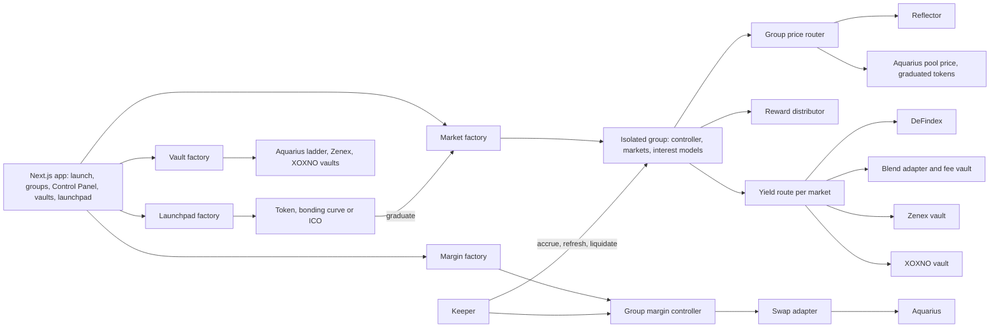

# Peridot Markets

Isolated money markets for any Stellar token, created from a factory. A project launches a token (simple, bonding curve or ICO), gets its own lending and borrowing group with configurable rates, collateral factors, caps and optional leverage, routes idle liquidity into DeFindex, Blend, XOXNO, Zenex or Aquarius, and manages everything from a Control Panel inside factory guardrails. Built for HackMeridian 2026 on top of Peridot's audited lending core.

| | |
|---|---|
| Mainnet app | https://markets.peridot.finance |
| Testnet app | https://test-markets.peridot.finance (free test tokens, same code, network switch in the header) |
| Contract IDs | [deployments/mainnet.json](deployments/mainnet.json), [deployments/testnet.json](deployments/testnet.json) |
| Verified facts for the pitch | [docs/PITCH-FACTS.md](docs/PITCH-FACTS.md) |
| Docs index | [docs/README.md](docs/README.md) |

Status as of 26 October 2026. Beta: the new contracts are unaudited and every market is capped. Mainnet balances are tiny demo amounts (about 30 XLM supplied in total).

## The problem

A new token on Stellar has nowhere to be lent, borrowed or used as collateral. Existing money markets list assets by governance, in one shared risk pool, with parameters the token's community cannot set. Idle deposits earn nothing unless the market itself integrates every yield venue.

## The solution

One factory deploys a complete, isolated market group per token or community: its own controller, price router, markets, interest models and optional rewards and margin contracts. The group owner sets rates (0% is allowed), collateral factors, supply and borrow caps, a liquid buffer and a yield route per market, and changes them later through staged, guardrailed Control Panel transactions. Groups never share risk. The audited Peridot core does the lending; this repository adds the factories, the adapters, the launchpad, the frontend and the keeper.



## What is built

| Feature | Status | Evidence |
|---|---|---|
| Market groups (factory, isolated controller, markets, rates, caps, buffer, rewards) | Live on mainnet: 3 groups, 4 markets, funded XLM rewards with a real claim | [DEMO-MAINNET.md](docs/DEMO-MAINNET.md) |
| Margin and leverage (margin factory, per-group audited margin controller, Aquarius swap adapter) | Enabled on mainnet group 1 (3x max). Open and close transactions verified on testnet only; no mainnet position yet | [PITCH-FACTS.md section 6](docs/PITCH-FACTS.md) |
| Reflector pricing | Live on mainnet: all 4 markets priced from the Reflector external feed | [DEMO-MAINNET.md](docs/DEMO-MAINNET.md) |
| DeFindex route | Live on mainnet: group 1 XLM market, 80% of supply routed to the Peridot XLM DeFindex vault | [DEMO-MAINNET.md](docs/DEMO-MAINNET.md) |
| Blend route (fee vault plus adapter) | Live on mainnet: group 3 XLM market, supply and withdrawal verified | [DEMO-MAINNET.md](docs/DEMO-MAINNET.md) |
| Aquarius swaps | Mainnet: XLM/USDC pool allowlisted and bound as the margin swap venue, no swap executed yet. Testnet: graduation creates an Aquarius pool and locks the LP | [DEMO-TESTNET.md](docs/DEMO-TESTNET.md) |
| Aquarius ladder vault (concentrated liquidity rungs, rebalance, wind-down) | Testnet only: deposit, three rebalances, withdrawal and unwind. Mainnet Wasm upload is waiting on a cost decision | [deployments/testnet.json](deployments/testnet.json) |
| Zenex vault | Deployed on mainnet against the real Zenex (market unbound, no deposit). Deposit, sync and withdraw verified on testnet against a mock, since Zenex has no testnet | [deployments/mainnet.json](deployments/mainnet.json) |
| XOXNO vault | Live on mainnet against the real XOXNO Lending controller: 5 XLM deposit and 2 XLM withdrawal | [deployments/mainnet.json](deployments/mainnet.json) |
| Vault factory (one Wasm per vault kind, anyone creates a vault) | Live on mainnet with the Zenex and XOXNO kinds registered; Aquarius kind on testnet | [DEMO-MAINNET.md](docs/DEMO-MAINNET.md) |
| Launchpad: simple token | Mainnet factory supports it (`create_plain_token`); demo token SIMPL launched on testnet | [deployments/testnet.json](deployments/testnet.json) |
| Launchpad: bonding curve | Live on mainnet: PDEMO launched with a 5 XLM creator buy, still trading | [DEMO-MAINNET.md](docs/DEMO-MAINNET.md) |
| Launchpad: ICO (fixed price, soft and hard cap, refunds) | Mainnet factory upgraded with the ICO Wasm, no ICO created there yet. Success and refund flows complete on testnet | [deployments/testnet.json](deployments/testnet.json) |
| Launchpad: graduation into an Aquarius pool and a new market group | Testnet only (PGRAD). Mainnet graduation needs the 300,000 AQUA pool fee | [DEMO-TESTNET.md](docs/DEMO-TESTNET.md) |
| Control Panel (staged parameter changes, guardrails, add market, margin sync) | Live in the app on mainnet. Edits verified on testnet; guardrail rejection verified on mainnet by simulation; no mainnet edit sent yet | [docs/qa/FINDINGS.md](docs/qa/FINDINGS.md) |
| Keeper (interest accrual, boosted-vault refresh, liquidation) | Running for mainnet group 1 on a droplet: hundreds of refresh and accrual transactions. Liquidation path tested, not exercised live | [KEEPER.md](docs/KEEPER.md) |
| Wallet picker (Stellar Wallets Kit) | Built: Albedo, Freighter, xBull, LOBSTR and Hana | `app/src/wallet/catalog.ts` |

Not built: hosted keeper subscriptions, Aquarius LP loss reserve, custom per-asset margin fees, switching a market's yield route after launch.

## Architecture at a glance



The factory stays contract admin of every group contract. The group owner acts through factory entry points that enforce guardrails and emit events. Details: [ARCHITECTURE.md](docs/ARCHITECTURE.md), contract specs: [SPECS.md](docs/SPECS.md).

## Repository layout

```
contracts/        New contracts (unaudited): market-factory, margin-factory, price-router-ext, reward-distributor,
                  blend-vault-adapter, xoxno-vault, zenex-vault, aquarius-vault, vault-factory, launchpad-token,
                  launchpad-curve, launchpad-factory, launchpad-ico, peridot-interfaces (shared types), mocks/
core/             Peridot's audited lending core, imported at a pinned commit; only timelocks changed (core/CORE_DIFF.md)
app/              Next.js 15 frontend (wallets, launch wizard, groups, Control Panel, vaults, launchpad), tests, QA harness
keeper/           Group-aware keeper: interest accrual, boosted-vault refresh, margin and lending liquidation
scripts/          Build and deploy scripts (stellar-cli), mainnet runbooks, droplet hosting, pitch tooling
deployments/      Generated manifests with every contract ID and Wasm hash per network (source of truth)
build/            Optimized Wasm used by deployments and by integration tests (build/test)
docs/             Specs, architecture, mainnet and testnet evidence, handoff specs, QA results (docs/README.md)
openzeppelin-stellar-contracts/  Vendored OpenZeppelin Stellar contracts v0.7.1, unmodified (MIT)
```

## Using it

Open the mainnet app or the testnet app and connect a wallet. Testnet is the place to try everything with free tokens.

| Do this | Where | What happens on chain |
|---|---|---|
| Browse groups and markets | `/groups`, `/groups/1` | Reads the factory and each group's controller |
| Supply and withdraw | `/groups/[id]` market card | `deposit` and `withdraw` on the market receipt vault; part of the supply is routed to the market's yield venue |
| Borrow and repay | `/groups/[id]` market card | Enter the market, `borrow` and `repay` on the group controller; health shown live |
| Claim rewards | `/groups/2` | `claim` on the reward distributor (group 2 holds the funded XLM rewards) |
| Open or close leverage | `/groups/1` Leverage tab | Staged margin V3 transactions through the group margin controller and the Aquarius swap adapter; state survives a refresh |
| Create a group | `/launch` wizard | `create_group`, then per market `add_market`, `activate_market`, `attach_yield`, then margin and rewards, each a confirmed transaction |
| Manage a group | `/groups/[id]/control` (owner only) | Staged `update_risk` and `update_rates`, `apply_pending` after 60 s, add market, pause, margin sync |
| Launch a token | `/launch-token` | Simple token, bonding curve (with optional creator buy) or ICO; tokens listed at `/tokens`, each at `/token/[address]` |
| Trade and graduate a curve | `/token/[address]` | `buy` and `sell` on the curve; at target, `graduate` creates an Aquarius pool, locks the LP and creates a market group |
| Create a vault | `/vaults` | `create_vault` on the vault factory with the chosen kind (Aquarius ladder, Zenex, XOXNO) and parameters |

Every write is simulated first, then signed in the wallet, then submitted and awaited; a submission hash alone is never treated as success.

## Developing

Prerequisites: Rust stable with the Wasm target used by stellar-cli, [stellar-cli](https://github.com/stellar/stellar-cli), `wasm-opt`, Node.js 22.12 or newer, Python 3 (deployment helpers).

### Contracts

```sh
cargo test --workspace                     # all crates (new contracts and the imported core)
cargo test -p market-factory               # one crate
INIT_ADMIN=<market-factory id> OUT_LABEL=testnet scripts/build_core.sh   # core Wasm, admin baked in
NETWORK=testnet IDENTITY=<stellar-cli identity> scripts/deploy.sh all    # build-new, factories, build-core, upload, externals
```

`scripts/deploy.sh` writes `deployments/<network>.json`; mainnet refuses to run without `CONFIRM_MAINNET=yes`. Further runbooks: `scripts/deploy_vault_factory.sh` (vault factory and kinds), `scripts/launchpad_mainnet.sh` and `scripts/ico_mainnet.sh` (launchpad), `scripts/zenex_vault_mainnet.sh`, `scripts/xoxno_vault.mjs`, `scripts/refresh_boosted_mainnet.sh`, `scripts/run_keeper_group1.sh`. Integration tests load the real core Wasm from `build/test/`.

### App

```sh
cd app
npm ci
cp .env.example .env.local                 # mainnet by default; NEXT_PUBLIC_NETWORK=testnet for testnet
npm run dev                                # http://localhost:3000
npm run typecheck && npm test              # unit tests (node --test)
npm run test:e2e                           # Playwright, mock mode (npx playwright install chromium first)
npm run build
```

| Variable | Purpose |
|---|---|
| `NEXT_PUBLIC_NETWORK` | `mainnet` or `testnet` (the header switch changes it at runtime) |
| `NEXT_PUBLIC_MAINNET_RPC_URL` | Browser-safe mainnet Soroban RPC |
| `NEXT_PUBLIC_TESTNET_RPC_URL` | Testnet RPC, defaults to `https://soroban-testnet.stellar.org` |
| `NEXT_PUBLIC_READ_ONLY` | `true` disables every transaction submission |
| `NEXT_PUBLIC_USE_MOCKS` | `true` only for a local demo without a chain |

Browser variables are public; never put a key in them. Contract IDs come from `deployments/<network>.json`, copied into the app with `node scripts/sync-deployments.mjs <network>` from `app/`. The app bundles a generated snapshot of the contract interface types (`npm run interfaces:check` in CI).

### Keeper

```sh
cd keeper/liquidator/margin
npm ci && npm run check && npm test
cp mainnet-group1.env.example .env         # dedicated keeper key, dry-run by default
npm start
```

Operations, fee caps and the droplet service are in [KEEPER.md](docs/KEEPER.md). CI (`.github/workflows/frontend-keeper.yml`) runs the app typecheck, unit and e2e tests and the keeper tests.

## Contracts (mainnet deployment)

All IDs are copied from [deployments/mainnet.json](deployments/mainnet.json). Admin and deployer: `GC3FLITV3KLO5RUJLJWXM5O5MMWVDIF5RX64Y46YZFHP3WVYQBF37CXH`.

| Contract | ID |
|---|---|
| Market factory | `CBGW6LMUXRZ7OB6SUOZELAFJOQV74E4ME4S4ZPGD5IFY32LSMQFMCQ7S` |
| Margin factory | `CCTFHRHDJM4BH6O2R325L6JXYWVCUDCM2IBO3BLRCE53KDM5JR5YZ6YH` |
| Group 1 "Meridian" controller | `CCIVCL6B5TNYC5PTJDFXD24AEJ5VQU5XUTZXFFGMIVRWQSSZFZPIPUES` |
| Group 1 price router | `CBBZ2FPMJDFSGQD64Y6U4IKJ7YXO2RP5T5AQMXRNBYKFXZOTGMFTF3XD` |
| Group 1 USDC market | `CCZHYRBCNKB5F3RPMD4VV747NIV6QFJ4EBZLPWDSQWHNNKYDO62OVIRM` |
| Group 1 XLM market (DeFindex route, 0% borrow rate) | `CCK7R22G3HOZDJXU6DVDEXK4HZ6AS3DHHFCAFOMY22XQEA3DJHRRSNXI` |
| Group 1 margin controller | `CCWAUBM6C5RRPBFKJK57I56GXRCILOKRVJEOAGEI7ZHKXVSOHEL5JPEY` |
| Group 2 "Rewards" controller | `CADHYBWKFNDE3LKNWCRD7F6FNHTNQAR4W3AT2G3TROO7V6RZ2VMUKZSZ` |
| Group 2 XLM market | `CARDJEVXDP5RY3GAKRYSW4T5CKYY7Y4PQTS4CJSVQEBKP4JMHTDFPXNV` |
| Group 2 reward distributor | `CA4AMJK54MZI2KDU5KJFPF5SD4KULJETIITPVVQH5WTEH2WH6IKOSYUF` |
| Group 3 XLM market (Blend route) | `CCUQUYBW3LJXPYB5U5QIDBDWPMKYVBPCIHQZSSXOSAV2SIXOBDNHSUDM` |
| Group 3 Blend adapter | `CDLLNAM63H5BVYH4BCNIWY6AULTDO6H455M4NF3HIYUW4XBXW6TPOPIX` |
| Peridot Blend fee vault | `CCHILGAYU4DQXLWSTOA5BQYZD7QJMWUU5PQLS4Z25FLI2WP6IVV3X337` |
| Launchpad factory | `CAN6YNLFZHMLHPZAMSLR2BTIM7VOS6YZEXJSZAXQEHKPO7BN4RP5NA7J` |
| PDEMO token and bonding curve | `CDKHQPYSBULW3T2FNLPKKKXVKREDYZTI37KRURBNVNEUIZ5YDT4O4DYT`, `CDWJL4YJ4H546FFXNXSNREW27PFQFNMBQPXDIUHTN765Z52MRDUJH43A` |
| Vault factory | `CBWWQGA6ZURTB5IVZO3Q2EQBOSO4FDGLKNUNUWX5Q57TWKHHYFGRAJTW` |
| XOXNO demo vault | `CCXPXDV3VXQE2WHOQOBRO7XSQTPJXSYWRF4H3UHIEWNVGL2RRYDIHCDC` |
| Zenex demo vault | `CD6ZTDY6MTACM5D3BY7OW3SXZDAQ322RQUOFEFXBWU44TLO4LXIZQRMP` |

External contracts used: Reflector feeds, the Aquarius router and XLM/USDC pool, the Blend Fixed V2 pool, the Peridot XLM DeFindex vault, XOXNO Lending and Zenex (all listed under `external` in the manifest). Testnet IDs are in [deployments/testnet.json](deployments/testnet.json).

## Safety and guardrails

- Groups isolate risk: separate controller, router, markets, margin controller and swap adapter per group.
- Factory guardrails (`contracts/market-factory/src/guardrails.rs`): collateral factor 1% to 75% with Reflector prices and at most 50% with pool prices; supply and borrow caps required; liquid buffer 10% to 100%; reserve factor at most 50%; at most 16 markets and 4 margin markets per group; group leverage 1x to 5x, 2x for pool-priced tokens; slippage at most 10%; no admin fallback prices.
- Staged changes: collateral factor and price changes wait 60 s before `apply_pending`; the UI shows the countdown. Every owner action emits an event.
- Margin V3 runs as staged transactions with persisted recovery; an unknown outcome is never retried automatically.
- The keeper uses its own key, caps fees per transaction and per day, journals intents in PostgreSQL and defaults to dry-run.
- Launchpad: 1% trade fee, creator buys capped at 5% of the curve, LP shares locked by transfer to the zero account, ICO funds held in escrow until finalize, refunds on a missed soft cap.
- Mainnet scripts refuse to run without `CONFIRM_MAINNET=yes`; secrets never live in the repo or in browser variables.

## Known limitations and unaudited contracts

- Everything under `contracts/`, `app/` and `keeper/` was written or adapted during the event and is unaudited. The audit covers only the imported core.
- The core's upgrade and admin timelocks were shortened from 24 h to 60 s for the event ([core/CORE_DIFF.md](core/CORE_DIFF.md)); new contracts can be upgraded immediately by the admin. Production needs longer delays and multisig administration.
- Once a group has a reward token, no market can be added to it (core re-entry limit). Enable rewards last.
- Boosted-vault markets (DeFindex, Blend) need a health-cache refresh at least every 5 minutes or borrows revert; the keeper does this for group 1 only.
- No mainnet borrow, margin open, Control Panel edit or third-party user yet; those flows are verified on testnet and by mainnet simulation.
- Graduation on mainnet costs 300,000 AQUA (Aquarius pool fee), and pool-based pricing of graduated tokens can be manipulated; mitigated by the 50% collateral cap, depth floor and step guard, not solved.
- Zenex withdrawals are asynchronous (at least one hour) and shares can lose value. Public token sales may need legal review (MiCA) before Peridot promotes them.
- The Blend fee-vault Wasm is built from script3/fee-vault `1ab9835` and is not byte-identical to an upstream release.

## Prior work and licence

Peridot's lending core, margin controller, price router, Aquarius LP vault, dashboard base and liquidator bots predate the event and were imported at pinned commits; the exact sources, commits and the only core change are listed in [docs/PRIOR_WORK.md](docs/PRIOR_WORK.md) and [core/CORE_DIFF.md](core/CORE_DIFF.md). Everything else (factories, adapters, vaults, launchpad, frontend flows, keeper changes, scripts, docs) was built during HackMeridian 2026 and is visible in the commit history.

This repository does not publish a licence of its own. `openzeppelin-stellar-contracts/` is vendored under its own MIT licence. The frontend prior work carries no licence, as recorded in `docs/PRIOR_WORK.md`.

## Team

Built by the Peridot team for HackMeridian 2026, Lisbon.
