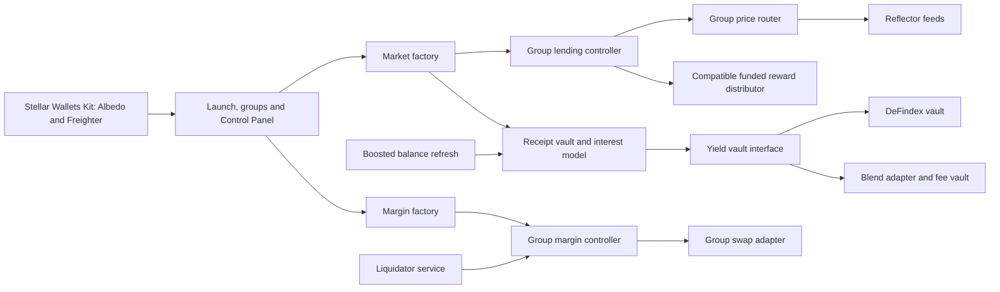

# Architecture

Peridot Markets is being built around isolated lending groups. The factory remains contract admin; a group's owner requests changes through factory guardrails. The factories, three demo groups, DeFindex and Blend routes, and funded rewards are deployed on mainnet. [Deployer evidence](DEMO-MAINNET.md) and [frontend acceptance](DEMO.md) are tracked separately; fresh Albedo flows and live worker coverage remain pending.

## Transaction boundary

The browser builds a network-specific contract call, simulates it, presents the operation for wallet signing, submits the signed transaction and waits for ledger success. A submission hash alone is not completion. An unavailable confirmation remains an unknown outcome and must be reconciled before retrying. A missing transaction is considered expired only when the RPC ledger clock has passed its time bound and retained history covers the entire submission window. RPC passphrase checks apply to reads and writes. Browser Web Locks serialize signing and reconciliation across tabs; only the matching pending hash is cleared. Pool registry BytesN keys are decoded from raw XDR. Until registry getters are exposed, router and trusted/denied policy are read from public factory storage with strict schema checks; malformed policy rejects discovery.

Amounts use token decimals and integer arithmetic. Receipt-share withdrawals and underlying-token deposits are distinct units. Wallets connect through Stellar Wallets Kit, with Albedo selected by default and Freighter available. Wallet network, account, transaction hash and signature are checked for each signing operation. Mainnet is the intended default; testnet and explicit mocks are separate configurations.

## Contracts and group isolation

The canonical Rust types and TypeScript mirror live in [peridot-interfaces](../contracts/peridot-interfaces/). Lead A owns interface changes. Deployments are produced by Lead A's deployment scripts; the frontend and workers consume those manifests rather than inventing addresses.

Each group has its own controller, price router, markets and optional rewards and margin contracts. Mainnet contract IDs and asset addresses are recorded in the [deployment manifest](../deployments/mainnet.json) and the [README contracts table](../README.md#contracts-mainnet-deployment). Meridian (group 1) retains an open market list without rewards; Rewards (group 2) has the funded distributor; BlendDemo (group 3) isolates the Blend route demonstration. Existing Peridot mainnet addresses are reference deployments and are not evidence that this new factory is deployed.

## Yield, pricing and rewards

Phase 1 routes are retained liquidity, DeFindex and Blend. Aquarius with a capped loss reserve is phase 2. Guarded prices and Zenex are phase 3; XOXNO and hosted keeper subscriptions are phase 4. Later routes remain unavailable until deployed and verified.

Reflector discovery checks the Stellar-assets and external feeds with their proper asset keys. The factory never sets fallback prices. Reward compatibility must match the pinned controller's balance/transfer calls; a mint-only distributor would not work with that core.

## Staged operations

Core collateral-factor updates have a 60-second delay. The UI reads on-chain proposed values and ETA for the countdown. Changing configuration inside an existing router must be staged by the factory; setting the same oracle address does not create a core delay.

Market creation uses three confirmed owner transactions: `add_market`, `activate_market`, and `attach_yield`. This stays below the network ledger-entry limit. Only activated markets appear in a group. The pinned core currently prevents adding markets after rewards are enabled, so launch creates every market first and sets rewards last. Both collateral and borrowed markets must be entered on the controller. Reward-bearing supply also requires entry before the deposit, so accrual starts with the first supplied balance.

After a confirmed `apply_pending` market change in a margin-enabled group, Control Panel submits `margin_factory.sync_pairs(group_id)` as a separate transaction to refresh leverage limits. It preserves the market-change receipt and exposes manual synchronization recovery if the second transaction is interrupted.

Margin V3 spans several transactions. Pending stages and transaction hashes must survive refresh and distinguish an unresolved transaction from a completed stage. Separate swap adapters and verified pool bindings keep groups isolated.

## Operations

Ordinary lending liquidation and margin liquidation use distinct paths. Workers accrue interest before health scans, reject nested source-account authorization, validate topology before live submissions, retain durable transaction intents and cap fees. Ordinary liquidation checks net collateral value after the protocol fee against explicit profit and cost buffers. These buffers cannot guarantee realized proceeds or receipt liquidity. Phase 1 also needs permissionless boosted-value refreshes for DeFindex and Blend before the cache becomes stale. Idle-cash rebalancing is admin-only in the pinned core and needs an authorized factory path.

Workers use a dedicated fee-paying identity. No browser environment variable may contain signing secrets. Live worker execution, deployment with keys and spending funds require Joshua's approval.

## Redesigned frontend and wallet lifecycle

The `ui-redesign` branch was merged as `82fcde0`. The active shell is `app/src/components/ui/AppShell.tsx`, including wallet selection, network checks, cancellation and pending-transaction reconciliation. Control Panel leverage limits come from `margin_factory.effective_max_leverage`.

Wallet modules initialize before Connect is enabled. After simulation, Albedo signing pauses at an explicit review dialog; its button opens Albedo synchronously in the click gesture so Safari can allow it. The dialog shows the method, network, account and maximum fee. Cancellation, expiry or account changes reject the signer promise before submission. The Kit still verifies the exact transaction hash, source and account signature. Wallet requests expire after 60 seconds. Albedo has no supported popup cleanup API, so users must close a cancelled popup before retrying.

Overview cards read only token metadata and market totals. Identical concurrent contract reads coalesce; completed financial values are not cached. Reads are paced to at most three concurrent requests and one start every 200ms; HTTP 429 read failures retry at most twice. The RPC request timeout is 30 seconds. Mutation outcomes and pending-transaction reconciliation invalidate in-flight reuse. No retry is added to `sendTransaction`. Lending renders before optional margin details, with actions disabled until balances match the current wallet. Margin and reward state clear during refresh. E2e uses a separate `.next-e2e` directory so it cannot replace a running production preview's files.
