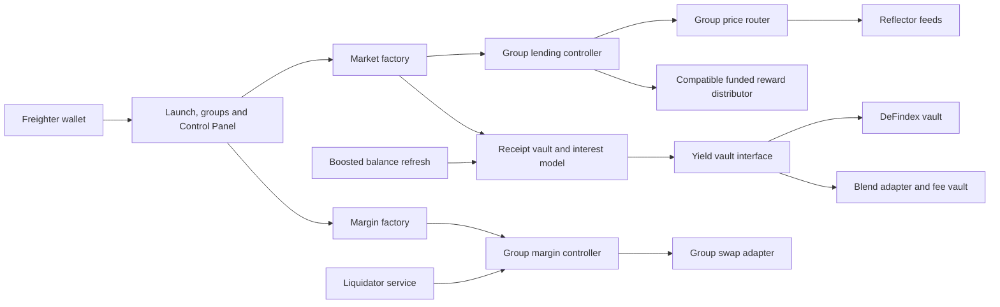

# Architecture

Peridot Markets is being built around isolated lending groups. The factory remains contract admin; a group's owner requests changes through factory guardrails. This page describes the intended architecture. Deployment and transaction evidence remains pending until recorded in [DEMO.md](DEMO.md).

## Transaction boundary

The browser builds a network-specific contract call, simulates it, presents the operation for wallet signing, submits the signed transaction and waits for ledger success. A submission hash alone is not completion. An unavailable confirmation remains an unknown outcome and must be reconciled before retrying.

Amounts use token decimals and integer arithmetic. Receipt-share withdrawals and underlying-token deposits are distinct units. Wallet network and account are checked for each signing operation. Mainnet is the intended default; testnet and explicit mocks are separate configurations.

## Contracts and group isolation

The canonical Rust types and TypeScript mirror live in [peridot-interfaces](../contracts/peridot-interfaces/). Lead A owns interface changes. Deployments are produced by Lead A's deployment scripts; the frontend and workers consume those manifests rather than inventing addresses.

Each group has its own controller, price router, markets and optional rewards and margin contracts. Mainnet contract IDs and asset addresses will be linked from the deployment manifest after deployment. Existing Peridot mainnet addresses are reference deployments and are not evidence that this new factory is deployed.

## Yield, pricing and rewards

Phase 1 routes are retained liquidity, DeFindex and Blend. Aquarius with a capped loss reserve is phase 2. Guarded prices and Zenex are phase 3; XOXNO and hosted keeper subscriptions are phase 4. Later routes remain unavailable until deployed and verified.

Reflector discovery checks the Stellar-assets and external feeds with their proper asset keys. The factory never sets fallback prices. Reward compatibility must match the pinned controller's balance/transfer calls; a mint-only distributor would not work with that core.

## Staged operations

Core collateral-factor updates have a 60-second delay. The UI needs on-chain proposed values and ETA for a reliable countdown. Changing configuration inside an existing router must be staged by the factory; setting the same oracle address does not create a core delay.

Margin V3 spans several transactions. Pending stages and transaction hashes must survive refresh and distinguish an unresolved transaction from a completed stage. Separate swap adapters and verified pool bindings keep groups isolated.

## Operations

Ordinary lending liquidation and margin liquidation use distinct paths. Phase 1 also needs permissionless boosted-value refreshes for DeFindex and Blend before the cache becomes stale. Idle-cash rebalancing is admin-only in the pinned core and needs an authorized factory path.

Workers use a dedicated fee-paying identity. No browser environment variable may contain signing secrets. Live worker execution, deployment with keys and spending funds require Joshua's approval.
