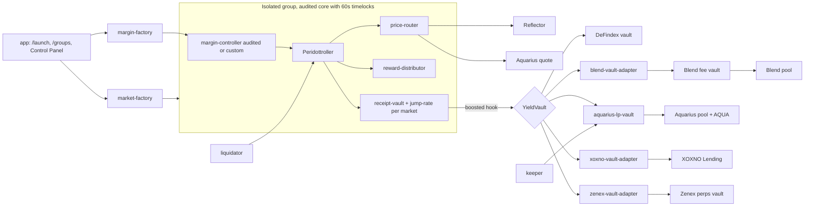

# 00 HackMeridian Dropoff: Peridot Markets (lead agent + factory)

This is the master file. Every agent reads **sections 0 to 7**, **`11-ADDRESSES.md`** (verified contract addresses and interfaces for every integration) and its own handoff. The lead agent (who also builds the market factory) reads all of it.

| File | Agent | Phase |
|---|---|---|
| 00-DROPOFF.md | Lead A: market factory, integration, deploys | all |
| 01-VAULT-AQUARIUS.md | Aquarius LP vault | 2 (CL in 4) |
| 02-VAULT-BLEND.md | Blend fee-vault adapter | 1 |
| 03-VAULT-XOXNO.md | XOXNO adapter | 4 |
| 04-VAULT-DEFINDEX.md | DeFindex route | 1 |
| 05-PRICE-ROUTER.md | Price router | 1 (guard modes 3) |
| 06-MARGIN-FACTORY.md | Margin factory, custom margin, liquidator | 1 (custom 3) |
| 07-FRONTEND.md | Lead B: app | all |
| 08-KEEPER.md | Keeper | 2 (hosted 4) |
| 09-REWARDS.md | Reward distributor | 1 |
| 10-VAULT-ZENEX.md | Zenex perps vault adapter | 3 |
| 11-ADDRESSES.md | Registry: addresses and verified interfaces | reference |
| KICKOFF-PROMPTS.md, PITCH-AND-VIDEO.md | Joshua | |

## 0. Where you are and where you build

You are started inside the existing repo **`Peridot-Soroban`**. That repo is your **reference** (audited core contracts, scripts, dashboard, bots). **Do not commit hackathon work to it.**

**Branch first.** `main` is stale (June 2026). The current code is on **`leveraged-fix`** (12 Oct 2026). Run `git fetch --all && git log -1 --format='%h %cd' origin/leveraged-fix` and ask Joshua once which commit is the reference (default: `origin/leveraged-fix` HEAD). Check it out read-only (`git worktree add ../peridot-ref origin/leveraged-fix` is fine) and record the SHA in `core/CORE_DIFF.md` and `docs/PRIOR_WORK.md`. `peridot-bots/` only exists on `main`; take the liquidator and rebalance bot from there.

**Read what already exists before building anything** (all on `leveraged-fix`, all prior work):

| Existing in `peridot-contracts/` | What it is | Use in this build |
|---|---|---|
| `contracts/aquarius-lp-vault` (~10k lines) | Aquarius LP vault behind a receipt-vault boosted hook. Works on Aquarius **concentrated** pools; full-range bounds for stable pairs (`full_range_bounds`) or a centered range (`centered_range`, half-width 40 ticks on mainnet) moved by keeper `rebalance`; AQUA `harvest` and sell; oracle NAV and pool-divergence checks. Already implements `deposit` / `withdraw` / `get_asset_amounts_per_shares`. Mainnet pilot live (see 11). **No loss reserve yet.** | Base for 01. Do not rewrite it. |
| `contracts/price-router` | Reflector-compatible router (`lastprice`, `decimals`, `resolution`) that bounds every source, including executable Aquarius pool quotes and optional peg ceilings; built because Reflector lacks yXLM and PYUSD. | Base for 05. Extend, do not rewrite. |
| `contracts/lp-receipt-vault`, `lp-lending-vault`, `lp-peridottroller` | LP-share lending markets and the isolated LP controller (pilot). | Reference only; not in phase 1. |
| `contracts/mocks/mock-aquarius-pool`, `mock-depth-fixture` | Test fixtures for Aquarius pools. | Use in tests for 01, 05, 06. |
| `scripts/run_aquarius_vault_keeper.sh` | Keeper loop: refresh NAV, recenter range, harvest, refresh boosted value. | Port into `keeper/` (08). |
| `scripts/deploy_aquarius_*_mainnet.sh`, `rollout_aquarius_*`, `deploy_margin_mainnet.sh` | Working mainnet deploy order for LP markets and margin. | Copy the call order into `scripts/deploy.sh` steps. |
| `addresses.md` | Current testnet and mainnet addresses, verified Aquarius pools, DeFindex vaults, settings snapshot. | Source for 11-ADDRESSES.md. |

Create a **sister folder** next to it and build everything there:

```bash
cd ..                       # parent of Peridot-Soroban
mkdir peridot-markets && cd peridot-markets && git init
# Joshua creates the public GitHub repo PeridotFinance/peridot-markets; add it as origin
```

Final layout:

```
<parent>/
  Peridot-Soroban/          reference only, never modified (on leveraged-fix it vendors openzeppelin-stellar-contracts/ inside the repo)
  peridot-markets/          NEW public repo, everything below is hackathon work
    README.md
    core/                   copy of the audited core crates from ../Peridot-Soroban, timelocks set to 60s (only change)
      CORE_DIFF.md          exact diff vs Peridot-Soroban@<SHA>
    contracts/              Cargo workspace, soroban-sdk 25.3.0 (match the reference branch's workspace Cargo.toml)
      peridot-interfaces/   shared traits + types (section 6)
      market-factory/       groups, markets, control panel, upgrades
      (price-router and aquarius-lp-vault come from the reference in core/ and are extended by additive wrappers, see 01 and 05)
      reward-distributor/   per-group reward token, per-market speeds
      margin-factory/       margin per group, customizable
      margin-controller-custom/   phase 3: fork of audited margin-controller with per-asset leverage + fees
      blend-vault-adapter/
      aquarius-loss-reserve/  phase 2: loss-reserve wrapper around core/aquarius-lp-vault
      mocks/
    adapters/xoxno-vault-adapter/   phase 4, own workspace (soroban-sdk 28)
    keeper/                 phase 2
    app/                    frontend: copy of Peridot-Soroban/peridot-dashboard, then extended
    scripts/                build_core.sh, deploy.sh, demo scripts
    deployments/            testnet.json, mainnet.json
    docs/                   ARCHITECTURE, SPECS, PRIOR_WORK, MILESTONES, DEMO, KEEPER, PHASES
    .github/workflows/
```

**Using the audited core (hackathon copy with 60s timelocks):** copy the crates `receipt-vault`, `simple-peridottroller`, `jump-rate-model`, `margin-controller`, `swap-adapter`, `aquarius-lp-vault`, `price-router`, and `mocks/mock-token`, `mocks/mock-aquarius-pool`, `mocks/mock-depth-fixture` from the reference branch's `peridot-contracts/contracts/` into `peridot-markets/core/` as members of the `contracts/` workspace (copy `openzeppelin-stellar-contracts/` too, or fix the path deps). Keep each crate's Cargo features as they are; do **not** enable `hybrid-rewards` or `lp-receipt-prototype` on `aquarius-lp-vault` (both refuse to build for wasm by design). Commit the untouched copy first (`import audited core from Peridot-Soroban@<SHA>`). Then make **only these constant changes**, in a second commit:

| File | Constant | Audited | Hackathon |
|---|---|---|---|
| `simple-peridottroller/src/constants.rs` | `UPGRADE_TIMELOCK_SECS` | `24 * 60 * 60` | `60` |
| `simple-peridottroller/src/constants.rs` | `ADMIN_PARAM_CHANGE_DELAY_SECS` (oracle, close factor, liquidation incentive, market CF) | `24 * 60 * 60` | `60` |
| `receipt-vault/src/constants.rs` | `UPGRADE_TIMELOCK_SECS` | `24 * 60 * 60` | `60` |
| `margin-controller/src/constants.rs` | `UPGRADE_TIMELOCK_SECS` | `24 * 60 * 60` | `60` |
| `swap-adapter/src/lib.rs` | `UPGRADE_TIMELOCK_SECS` | `24 * 60 * 60` | `60` |
| `jump-rate-model/src/lib.rs` | `UPGRADE_TIMELOCK_SECS` | `24 * 60 * 60` | `60` |
| `aquarius-lp-vault/src/constants.rs` | `UPGRADE_TIMELOCK_SECS` | `24 * 60 * 60` | `60` |
| `price-router/src/lib.rs` | `UPGRADE_TIMELOCK_SECS` | `24 * 60 * 60` | `60` |

Line positions differ between branches: grep for the constant names (`grep -rn "UPGRADE_TIMELOCK_SECS\|ADMIN_PARAM_CHANGE_DELAY_SECS" core/`) and change every occurrence that is a constant definition. Smart-account crates are not imported.

Leave `MAX_DEADLINE_SECONDS` in swap-adapter alone (that is a swap deadline, not a timelock). If core tests hardcode 24h warps, change them to use the constant. Run all core tests. Write `core/CORE_DIFF.md` with the exact diff. `scripts/build_core.sh` builds these to Wasm; new contracts get typed clients via `soroban_sdk::contractimport!` on those Wasm files. README wording: "core lending contracts are Peridot's audited contracts with one change for the hackathon: upgrade and admin-parameter timelocks shortened from 24h to 60s".

**Frontend base:** first commit in `app/` is a plain copy of `peridot-dashboard` from the reference branch with message `import dashboard base from Peridot-Soroban@<SHA> (prior work)`. Everything after that is new.

## 1. How to work: phases

Work **step by step**. Each phase ends with a working **mainnet** deployment, the frontend connected to it, docs updated, a git tag `phase-N`, and the submission updated. After phase 1 we have something we can submit; every later phase only adds.

| Phase | Goal | Agents |
|---|---|---|
| **1 MVP (mainnet, submit-ready)** target Sun 20:00 | Launch a group, add markets with per-market jump rate (0% allowed), CF, caps, liquid buffer; Reflector pricing; yield routes None, DeFindex, Blend; own reward token with per-market speeds; margin via margin factory using the audited margin-controller; owner Control Panel; add markets later; frontend live on mainnet; liquidator running for the group | Lead/factory, 05, 09, 02, 04, 06, 07 |
| **2 Aquarius** target Sun 23:59 | Aquarius LP vault with loss reserve, keeper (self-hosted) harvesting AQUA, mainnet harvest tx | 01, 08 |
| **3 Price + custom margin + Zenex** target Mon 04:00 | Reflector + Aquarius guard, Aquarius-only (restricted); `margin-controller-custom` with per-asset max leverage and open/close fees, selectable per group in margin factory; Zenex perps vault route for USDC markets (async adapter) | 05, 06, 10 |
| **4 More routes + hosted keeper** until freeze Mon 08:00 | XOXNO adapter; Peridot-hosted keeper on DigitalOcean with on-chain funding; switch yield route; CL range management | 03, 08, 01 |

Rules for phases:
- Do not start phase N+1 work on shared files until phase N is deployed to mainnet and tagged. Agents for later phases may build their own crate against mocks in parallel.
- Develop and test on **testnet**, then deploy the phase to **mainnet**.
- After each phase: update `docs/DEMO.md` with mainnet tx hashes, `deployments/mainnet.json`, README status table, and tell Joshua so he can update the submission.
- Code freeze **Mon 08:00 Lisbon**. Submission closes Mon 12:00.

## 2. What we are shipping

**One-liner:** "Any Stellar token gets its own money market in a few transactions: lending, borrowing, leverage and rewards, with idle liquidity routed into the best yield on Stellar."

A creator launches an **isolated market group** on Peridot and configures every market individually: interest rate curve (including 0% borrow), collateral factor, caps, reserve factor, how much stays liquid, where idle liquidity goes (DeFindex, Blend, Aquarius, Zenex, XOXNO, or nowhere), price source, leverage, and rewards in a token of their choice. Later the owner adds markets and changes any of this in the **Control Panel**. All within guardrails enforced by the factory.

**Track:** Scale + Stellar Composed. **Judges include the founders of XOXNO and of Zenith Protocols (Blend and Zenex).** DeFindex is an official partner. Integrate their protocols with their official contracts and SDKs, present them neutrally as destinations Peridot routes into, never as competitors.

## 3. How we are judged

- Build window Sun 25 Oct 09:00 to Mon 26 Oct 12:00 Lisbon, no late submissions. Anything before Sun 09:00 is prior work. The new repo makes this clean: its history starts at the event.
- Async judging of **demo video, pitch deck, GitHub repo, submission answers**. Finalists pitch Wed 28 Oct. $30K in XLM across 6 winners.
- Priority **Adoption, Discovery, Continuation**. Scale criteria: **milestones vs intake goals, SCF eligibility, production readiness, ecosystem impact.** Mainnet deployment speaks directly to production readiness.
- README with **specs** does most of the work. Portal needs: public repo, README (summary, problem, setup, install, env vars, demo), architecture (assets, contract IDs, integrations, APIs), live URL, onchain tx evidence, prior-work disclosure.

## 4. Hard rules for every agent

- **Never modify** anything in `../Peridot-Soroban`. In `peridot-markets/core/`, the only allowed changes are the five timelock constants in section 0. Any other core change needs Joshua's approval and an entry in `core/CORE_DIFF.md`.
- New logic plugs into the core through three existing seams: the **boosted-vault hook** (YieldVault), the **oracle address** (PriceRouter), and the **reward token address** (RewardDistributor). The only fork allowed is `margin-controller-custom` in phase 3 (based on `core/margin-controller`), with its diff documented line by line in `docs/PRIOR_WORK.md`.
- **Upgradeability:** every new contract exposes `upgrade(admin: Address, new_wasm_hash: BytesN<32>)` that upgrades immediately (`env.deployer().update_current_contract_wasm`), no timelock. Core contracts keep their two-step `propose_upgrade_wasm` then `upgrade_wasm`, now with a 60s delay; the factory exposes both steps.
- New contracts: `#[contracterror]` enums, `__constructor` for init, `require_auth` on every privileged call, events on every state change, TTL bumps on persistent keys.
- Work against **mocks of the shared interfaces** until real contracts exist.
- Copy: "loss reserve", "IL cover up to the reserve balance", never "guaranteed". No em dashes in user-facing copy or docs.
- Every agent writes its section into `docs/SPECS.md` and its IDs into `deployments/<network>.json` via `scripts/deploy.sh`, never by hand.
- **Secrets:** the mainnet admin key is a stellar-cli identity Joshua creates (`peridot-mainnet-admin`); the keeper uses a different key. Never commit keys or `.env` files.

## 5. Reference facts from Peridot-Soroban (verified)

- Core uses `initialize(...)` (no constructors), two-step admin (`set_admin`/`accept_admin`). Factory deploys core Wasm with `deploy_v2(hash, ())` and then calls `initialize`.
- Scales: CF, liquidation incentive, close factor, reserve factor in **1e6**. Margin `max_leverage` integer 1..=10, one value per margin-controller. Slippage 1e6 scale.
- `jump-rate-model::initialize(base, multiplier, jump, kink, admin)`: each of base, multiplier, jump at most `10_000_000`, kink at most `1_000_000`. **All zeros is valid = 0% borrow rate.** Check rate units in the contract and expose them as APR percent in the UI.
- Controller oracle: one per controller, calls `decimals()`, `resolution()`, `lastprice(Asset)`. If `lastprice` returns None it falls back to an admin fallback price if set. **The factory never sets fallback prices.**
- Controller rewards: `set_peridot_token(token)` once per controller (cannot be changed after), `set_supply_speed(market, speed_per_sec)` and `set_borrow_speed(market, speed_per_sec)` with max `1e12` per second, `claim(user)` pays by calling **`mint(to, amount)` on the reward token**. Arbitrary tokens do not let the controller mint, so we use a `reward-distributor` (09-REWARDS.md).
- Receipt-vault boosted hook: calls `deposit`, `withdraw`, `get_asset_amounts_per_shares`, `balance` on the boosted vault (00 §6.1). Idle cash buffer via `set_idle_cash_buffer_bps`.
- Reference scripts for exact wiring order: `Peridot-Soroban/peridot-contracts/scripts/deploy_testnet.sh`, `deploy_margin_controller_testnet.sh`, `deploy_mainnet.sh`.
- Bots: `Peridot-Soroban/peridot-bots/liquidator` (liquidation + idle cash rebalance).
- **Staged admin parameters in the controller:** oracle, close factor, liquidation incentive and market CF changes are staged with `ADMIN_PARAM_CHANGE_DELAY_SECS` (60s in our copy): the first call stages the value, a second call after the delay applies it. Read `set_oracle` and `set_market_cf` in `core/simple-peridottroller/src/contract.rs` to confirm the exact semantics, including whether the very first set on a fresh controller applies immediately (it matters for `create_group` and `add_market`).

## 6. Shared interfaces (canonical, in `contracts/peridot-interfaces`)

### 6.1 `YieldVault` (all vault adapters; DeFindex vaults already match)

```rust
fn balance(id: Address) -> i128;   // SEP-41 shares
// receipt-vault pre-authorizes exactly token.transfer(from = market, to = this, amount): pull with exactly that call
fn deposit(amounts_desired: Vec<i128>, amounts_min: Vec<i128>, from: Address, invest: bool) -> Vec<i128>;
// receipt-vault authorizes this as a sub-invocation: from.require_auth(); burn; pay underlying to `from`
fn withdraw(shares: i128, min_amounts_out: Vec<i128>, from: Address) -> Vec<i128>;
fn get_asset_amounts_per_shares(shares: i128) -> Vec<i128>;   // [underlying], never panics
// Peridot extensions
fn underlying() -> Address; fn kind() -> Symbol; fn market() -> Address;
fn get_state() -> VaultState;
fn harvest(keeper: Address, min_out: i128) -> i128;   // 0 if nothing to harvest
fn set_keeper(admin: Address, keeper: Address);
fn pause(admin: Address, paused: bool);
fn upgrade(admin: Address, new_wasm_hash: BytesN<32>);

#[contracttype] pub struct VaultState {
    pub kind: Symbol, pub underlying: Address, pub total_shares: i128, pub total_value: i128,
    pub principal: i128, pub reserve: i128, pub last_harvest_ts: u64, pub last_harvest_amount: i128,
    pub apy_hint_bps: u32, pub paused: bool,
}
```
Adapter constructor: `__constructor(admin /* factory */, market, underlying, cfg)`.

### 6.2 `PriceRouter` (one per group, set as the controller's oracle; 05-PRICE-ROUTER.md)

Reflector subset: `decimals() -> u32`, `resolution() -> u32`, `lastprice(asset: Asset) -> Option<PriceData>` (types copied from core `reflector.rs`). Config: `set_asset_config(admin, token, PriceConfig)`, `get_asset_config(token)`, `check(token) -> PriceCheck`, `upgrade`.

```rust
pub enum PriceConfig {
    ReflectorOnly { oracle: Address, asset: Asset },                        // phase 1
    ReflectorWithAquariusGuard { oracle: Address, asset: Asset, pool: Address, quote_token: Address, max_dev_bps: u32 }, // phase 3
    AquariusOnly { pool: Address, quote_token: Address },                   // phase 3, restricted
}
```

### 6.3 `RewardDistributor` (one per group, set as the controller's reward token; 09-REWARDS.md)

```rust
fn mint(to: Address, amount: i128);            // callable only by the group controller; pays out the real token from balance
fn fund(from: Address, amount: i128);          // anyone, typically the owner
fn withdraw_unallocated(admin: Address, to: Address, amount: i128);
fn reward_token() -> Address; fn balance_available() -> i128; fn upgrade(admin, hash);
```

### 6.4 Factory types

```rust
pub struct RateModel { pub base: u128, pub multiplier: u128, pub jump: u128, pub kink: u128 }  // core units, zeros allowed

pub enum YieldRoute {
    None,
    Defindex { vault: Address },                                   // phase 1
    Blend { fee_vault: Address },                                  // phase 1
    Aquarius { pool: Address, pair_token: Address, reserve_cut_bps: u32, reserve_cap_bps: u32 }, // phase 2
    Zenex { market: Address, vault: Address, target_buffer_bps: u32, min_buffer_bps: u32 }, // phase 3, USDC only, async (10-VAULT-ZENEX.md)
    Xoxno { hub_id: u32, spoke_id: u32 },                          // phase 4
}

pub struct MarketConfig {
    pub token: Address,
    pub collateral_factor: u128,  // 1e6
    pub supply_cap: u128, pub borrow_cap: u128,    // > 0
    pub reserve_factor: u128,     // 1e6
    pub rates: RateModel,
    pub idle_buffer_bps: u32,
    pub yield_route: YieldRoute,
    pub price: PriceConfig,
    pub margin_enabled: bool,
    pub supply_reward_per_sec: u128, pub borrow_reward_per_sec: u128,   // 0 if no rewards
}

pub struct GroupMarginConfig {
    pub variant: MarginVariant,           // Audited (phase 1) | Custom (phase 3)
    pub max_leverage: u128,               // 1..=5 (group); Custom adds per-asset caps
    pub max_slippage: u128,               // 1e6
    pub liquidation_incentive: u128,      // 1e6, 1_020_000..=1_150_000
    pub liquidation_fee: u128,            // 1e6, protocol share
}

pub enum KeeperMode { None, PeridotHosted, SelfHosted(Address) }

pub struct Group {
    pub id: u32, pub owner: Address, pub name: Symbol,
    pub controller: Address, pub price_router: Address,
    pub reward_distributor: Option<Address>, pub margin_controller: Option<Address>,
    pub markets: Vec<Address>, pub created_at: u64,
    pub keeper_mode: KeeperMode, pub keeper_paid_until: u64,
}
```

### 6.5 Deployments file

`deployments/<network>.json` (written by `scripts/deploy.sh`, copied to `app/src/lib/peridot/` and `keeper/`):
```json
{ "network": "mainnet", "core_commit": "<sha>",
  "factory": "C...", "margin_factory": "C...",
  "wasm": { "controller": "", "receipt_vault": "", "jump_rate": "", "margin": "", "margin_custom": "",
            "price_router": "", "reward_distributor": "", "blend_adapter": "", "aquarius_vault": "", "xoxno_adapter": "" },
  "external": { "reflector_stellar": "", "reflector_external": "", "aquarius_router": "", "blend_pool": "", "blend_fee_vault": "",
                "zenex_market_xlmusd": "", "zenex_vault_xlmusd": "", "xoxno_pool": "", "defindex_factory": "", "aqua": "", "blnd": "",
                "xoxno_controller": "", "defindex_vaults": { "USDC": "" }, "usdc": "", "aqua": "" },
  "swap_adapter": "", "demo": { "group_id": 0, "markets": {} } }
```

## 7. Architecture



## 8. Market factory spec (lead agent)

`contracts/market-factory`. The factory **stays admin** of every group contract; the creator is the group `owner` and acts through the factory, which enforces guardrails on creation and every update.

```rust
// setup (Peridot admin)
fn __constructor(admin: Address, wasm: WasmHashes, swap_adapter: Address, treasury: Address);
fn set_wasm(admin, wasm: WasmHashes);                   // new groups use new versions
fn set_allowlist_mode(admin, on: bool); fn set_creator_allowed(admin, creator, allowed: bool);
fn set_margin_factory(admin, margin_factory: Address);
fn upgrade(admin, new_wasm_hash: BytesN<32>);          // immediate
// hotfix pass-through for group contracts
fn upgrade_group_contract(admin, group_id, contract: Address, new_wasm_hash);  // new contracts: immediate upgrade
fn propose_core_upgrade(admin, group_id, contract: Address, new_wasm_hash);    // core contracts: their built-in path

// launch and grow (owner, one tx each)
fn create_group(owner: Address, name: Symbol) -> u32;                         // controller + price-router
fn add_market(owner, group_id, cfg: MarketConfig) -> Address;                 // any time, also after launch
fn attach_yield(owner, group_id, market: Address) -> Option<Address>;
fn set_rewards(owner, group_id, reward_token: Address) -> Address;            // once per group: deploy distributor, set_peridot_token
fn set_reward_speeds(owner, group_id, market, supply_per_sec: u128, borrow_per_sec: u128);
fn set_keeper_mode(owner, group_id, mode: KeeperMode);                        // phase 2+
fn fund_keeper(payer, group_id, token: Address, periods: u32);                // phase 4

// control panel (owner)
fn update_risk(owner, group_id, market, cf: u128, supply_cap: u128, borrow_cap: u128, reserve_factor: u128);
fn update_rates(owner, group_id, market, rates: RateModel);    // deploy new jump-rate, set_interest_model; zeros allowed
fn update_idle_buffer(owner, group_id, market, bps: u32);
fn update_price(owner, group_id, market, cfg: PriceConfig);
fn switch_yield(owner, group_id, market, route: YieldRoute);   // phase 4
fn pause_market(owner, group_id, market, deposit: bool, borrow: bool);
fn transfer_ownership(owner, group_id, new_owner: Address);
fn apply_pending(owner, group_id, market: Option<Address>);    // applies staged controller params once the 60s delay passed

// views
fn get_group(group_id) -> Group; fn list_groups(start: u32, limit: u32) -> Vec<Group>;
fn groups_of(owner) -> Vec<u32>; fn get_market_config(group_id, market) -> MarketConfig;
```

Staged params: `update_risk` (CF part) and `update_price` stage on the controller; the UI shows "applies in 60s" and calls `apply_pending`. If the first CF/oracle set on a fresh group is also staged, `create_group` / `add_market` leave the market paused for deposits until `apply_pending` runs; the wizard does this automatically after 60s.

Margin is handled by `margin-factory` (06-MARGIN-FACTORY.md); the market factory authorizes it per group and stores the resulting address in `Group.margin_controller`.

**Guardrails** (constants, documented in SPECS and shown in the UI):

| Param | Rule |
|---|---|
| Collateral factor | max 75% (Reflector pricing), max 50% (AquariusOnly) |
| Supply / borrow cap | required > 0 |
| Idle buffer | 10% to 100% |
| Rates | within core limits; all zeros allowed |
| Reserve factor | 0% to 50% |
| Price | phase 1 Reflector only; AquariusOnly markets cannot be margin-enabled |
| Rewards | speed at most core max; distributor balance shown publicly |
| Fallback prices | never set |

Deploy with `env.deployer().with_current_contract(salt).deploy_v2(hash, args)`, salt = `sha256(group_id || kind || index)`. Soroban resource limits require one tx per step (create, each market, each yield attach, rewards, margin).

Events: `GroupCreated`, `MarketAdded`, `YieldAttached`, `RewardsSet`, `RewardSpeedSet`, `MarginEnabled`, `ParamUpdated { group, market, param, old, new }`, `KeeperModeSet`, `KeeperFunded`, `OwnershipTransferred`, `Upgraded`.

Tests: full group lifecycle against core Wasm built from `core/`, every guardrail rejects, non-owner rejected, add market after launch, 0% rate market works, upgrade works.

## 9. Phase 1 acceptance (mainnet)

1. `create_group("Meridian")`. Markets: USDC (route Blend or DeFindex, 20% liquid, rates "stable" preset) and XLM (route DeFindex or None, rates with **0% borrow** to show the feature). Reflector pricing.
2. `set_rewards(<reward token>)`, fund distributor, set speeds on both markets.
3. Margin factory: audited margin-controller, max leverage 3x, both markets enabled.
4. Frontend on mainnet: supply, borrow, claim rewards, open and close a 2x position; Control Panel edits buffer, borrow cap and rates; guardrail rejects CF 90%; **add a third market after launch**.
5. Liquidator (existing bot, config pointed at the group) running.
6. Mainnet txs in `docs/DEMO.md`, `phase-1` tag, README status table updated. Joshua submits.

Seed with team funds and small caps. Label the app "beta, unaudited new contracts, capped".

## 10. Schedule (Sun 09:00 to Mon 12:00 Lisbon)

| Time | Work |
|---|---|
| Sun 09:00 to 10:00 | Lead: sister repo, build_core.sh + MANIFEST, interfaces + mocks, app base import, MILESTONES.md. Others: discovery. |
| 10:00 to 16:00 | Phase 1 build on testnet (factory, price-router, reward-distributor, Blend adapter, DeFindex check, margin factory, frontend on mocks then testnet) |
| 16:00 to 20:00 | Phase 1 integration, mainnet deploy, frontend on mainnet, docs, **tag phase-1, submit** |
| 20:00 to 24:00 | Phase 2 (Aquarius vault, keeper), mainnet harvest, tag |
| 00:00 to 04:00 | Phase 3 (guard pricing, custom margin, Zenex route), tag |
| 04:00 to 08:00 | Phase 4 (XOXNO, hosted keeper, switch yield), docs, fresh-wallet test, tag |
| **Mon 08:00** | **Code freeze.** Joshua: video, deck, final submission by 11:30 |

If a phase slips, finish and tag it before starting the next. A complete phase 2 beats a half-done phase 4.

## 11. README and docs

README order: links (live app, video, deck, architecture, specs) / status table per phase with mainnet IDs / track + what Peridot was before vs what this repo adds / problem / solution / try it / integrations table (Reflector, DeFindex, Blend, Aquarius, XOXNO, Freighter, Soroban deploy_v2) / contract IDs and key txs / milestones vs intake / prior work (core commit SHA, dashboard base commit) / setup, env vars / safety, guardrails, upgradeability / keeper options / roadmap and SCF / team.

`docs/PRIOR_WORK.md`: audited core imported from Peridot-Soroban@<SHA> with the timelock-only diff (`core/CORE_DIFF.md`), dashboard base import commit, `margin-controller-custom` diff vs core. Everything else built at HackMeridian.

## 12. Judge FAQ (README)

- **Arbitrary tokens, bad debt?** Isolated groups, required caps, CF limits, Reflector pricing, no fallback prices.
- **Owner abuse?** Owner acts only through the factory within guardrails; every change emits a public event shown in the Control Panel history.
- **Upgrades?** New contracts upgrade instantly by Peridot's admin for hotfixes; the audited core keeps its two-step upgrade with the delay shortened to 60s for the hackathon. Post-hackathon: restore longer delays and move admin to a multisig.
- **IL cover?** Phase 2 vault: share of Aquarius fees and AQUA rewards in a capped reserve; empty reserve means normal LP risk.
- **Rewards solvency?** Rewards are paid from a funded distributor; when it runs dry, accrued rewards remain claimable once it is refunded.

## 13. Two leads, one repo (coordination)

Two lead agents run in parallel, each with its own subagents:

| Lead | Tool | Owns (only these paths) |
|---|---|---|
| **Lead A: contracts** | Claude Code | `core/`, `contracts/`, `adapters/`, `scripts/`, `deployments/`, `docs/SPECS.md`, `core/CORE_DIFF.md` |
| **Lead B: app and ops** | Codex | `app/`, `keeper/` (incl. liquidator), `docs/` (except SPECS.md), `README.md`, `.github/` |

- Same clone, same branch `main`. Each lead stages **only its own paths** (`git add <paths>`), pulls with rebase before every push, small commits.
- `docs/COORDINATION.md` is the shared board, append-only, newest at the bottom, each entry prefixed `[A]` or `[B]` with time: status (`READY: scaffold`, `READY: testnet phase-1 deployed`, `READY: mainnet phase-1`), interface change requests, blockers, second-opinion summaries.
- Interface changes to `contracts/peridot-interfaces` (Rust and the generated TS in `contracts/peridot-interfaces/ts/`) only by Lead A, announced in COORDINATION.md before merging.
- **Second opinions:** Lead A asks Codex, Lead B asks Claude Code, read-only, at least before every mainnet deploy and phase tag, and whenever stuck for more than 30 minutes. Commands in `KICKOFF-PROMPTS.md`. The asking lead decides; summarize the answer in COORDINATION.md.
- **Ask Joshua before:** the first mainnet deployment of each phase, any use of the mainnet admin key outside `scripts/deploy.sh`, spending funds, or any core change beyond the timelock constants. Everything else: decide and keep moving.
